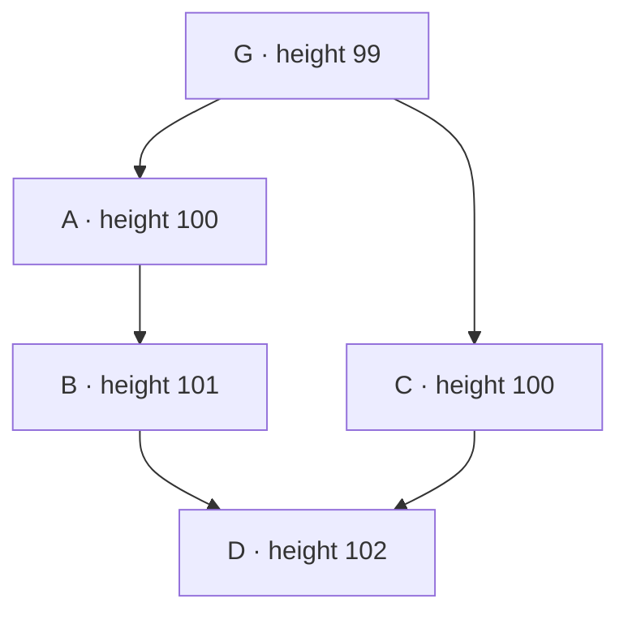

# DAG blocks, deploys, and transfers

Source-checked reference for explorer design and indexer development. Read the branch scope before using its implementation details.

**Reviewed: 2026-11-03.** The inspected sources are:

| Component | Revision | Scope |
|---|---|---|
| ASI indexer research baseline | `139ef50ed9acc54e66d4225edb811316da8e76c6` | `fix/node-896-exact-transfer-api`, including migrations 000–003; not yet merged into dev |
| ASI indexer dev / published image source | `3e2503ee4800437be3bb81f57aeba84a803e6df3` | Current dev before this documentation commit; migration 000 only |
| F1R3FLY Rust node | `9a86280a63f51e1d3af71f3ee917bd7cf6253084` | Local node source; node links below pin this revision |

These are inspected source revisions, not a verified deployed node/indexer pair. The node checkout can lag its remote and the source used by a published image. Check the actual deployment revision before applying these findings to a network. No live block-rate or DAG-width measurements are included.

**Branch scope:** this document preserves research against the exact feature
revision above. [PR #20](https://github.com/asi-alliance/asi-chain-indexer/pull/20)
(`feat/bigint-amounts` to dev) and
[PR #22](https://github.com/asi-alliance/asi-chain-indexer/pull/22)
(`fix/node-896-exact-transfer-api` to that feature branch) remain open at this
snapshot. Publishing this document on dev does not merge their runtime code.
Indexer source links below pin the research revision, including files absent
from dev. References to the inspected implementation describe that revision.

| Behavior | Dev at `3e2503e` | Inspected feature at `139ef50` |
|---|---|---|
| DAG parent storage and pending-deploy polling | Present | Present |
| Transfer storage | `BigInteger` dust and `Numeric(20,8)` display amount | uint256-range numeric storage and per-row token precision |
| Transfer detection | Source-pattern extraction | Execution-backed call/result reconciliation |
| Migrations 001–003 and `native_transfer_lifecycle` | Absent | Present |
| Exact-amount request/response adaptation for node #896 | Absent | Present |

## Rules for explorer design

- Identify a block by `block_hash`. `block_number` is a height shared by potentially many blocks.
- Display all parent links and preserve their `parent_index` order. Justifications are separate consensus references.
- An edge can connect non-adjacent heights. The child is one level above its **highest** parent, not every parent.
- Several blocks at one height can have `isFinalized = true`. The last finalized block (LFB) is a single selected block; it is not the set of all finalized blocks.
- Keep inclusion, execution outcome, and finality separate. A finalized containing block does not by itself prove that a deploy's effects survived merging into finalized state.
- Pending deploys are already polled in bulk. The snapshot covers one node's buffers, not the whole network.
- A `transfers` row represents a proved successful movement. Pending calls and rejected transfer attempts have a separate lifecycle view.

## Heights, width, and relationships

For a non-genesis block B:

```text
height(B) = 1 + max(height(P) for P in parents(B))
width(h)  = count(distinct block_hash where block_number = h)
```

Genesis has height 0. If B has parents at heights 100 and 101, its height is 102. The edge from the older parent spans two levels without violating the height rule. A missing intermediate height in an indexer result is a separate data-availability or synchronization question. See node [`Validate::block_number`][node-validation].



A and C share a parent and a height. D has two parents at different heights. Blocks sharing a height need not share a direct parent or have identical timestamps. Use “blocks at the same height” when that is the intended grouping; use “siblings” with its relationship made explicit.

Width varies by height. The transcript's estimates of “normally 1–4 blocks,” a universal maximum of 100, and `width <= active validators` are not established capacity limits. `seqNum` counts a creator's messages; it is not the block height. The node's equivocation check compares creator justifications with latest messages, rather than checking duplicate heights. See [`Validate::sequence_number`][node-validation] and [`EquivocationDetector::check_equivocations`][node-equivocation]. Use measured distributions for sizing, with pagination and overflow handling for wide levels.

A block can have multiple parents and multiple children. Parent selection has configuration and validation limits; do not turn a test default into a UI limit. In the indexer:

| Data | Representation |
|---|---|
| Block identity | `blocks.block_hash`, primary key |
| Height | `blocks.block_number`, indexed but not unique |
| Parent edge | `block_parents(block_hash, parent_hash, parent_index)` |
| Children | Reverse lookup of edges by `parent_hash` |
| Justifications | `blocks.justifications`, entries with `validator` and `latestBlockHash` |

The edge table has a foreign key on the child hash, but not on `parent_hash`. A parent reference can exist without a locally indexed parent row. Show that as unavailable data rather than silently removing the edge. Preserve the first-parent distinction, but do not infer current main-chain membership from `parent_index = 0` alone.

Sources: [models](https://github.com/asi-alliance/asi-chain-indexer/blob/139ef50ed9acc54e66d4225edb811316da8e76c6/src/models.py), [schema](https://github.com/asi-alliance/asi-chain-indexer/blob/139ef50ed9acc54e66d4225edb811316da8e76c6/migrations/000_comprehensive_initial_schema.sql), [Hasura relationships](https://github.com/asi-alliance/asi-chain-indexer/blob/139ef50ed9acc54e66d4225edb811316da8e76c6/scripts/configure-hasura.py). After the documented Hasura setup, `parent_links`, `child_links`, and the recursive `get_block_ancestors` / `get_block_descendants` functions expose the indexed DAG. Their results describe the local database, not necessarily every block held by the network.

## Production, finality, and synchronization

A proposal being constructed or signed, a receiving node accepting it into its DAG, and the block becoming finalized are different events. For explorer purposes, distinguish a block returned by the node from a deploy waiting in a submission buffer.

The inspected node's [`record_directly_finalized` and `held_ancestors`][node-dag] mark held DAG ancestry through **all** parent edges. Therefore two same-height ancestors of a finalized merge block can both be marked finalized. The old claim that only one block per height can ever be finalized is incorrect for this implementation. Neither “non-main parent” nor “same-height block” implies an invalid or permanently abandoned block.

Deploy finality is a separate question: the node's [`DeployFinalizationState`][node-deploy-status] distinguishes `Pending`, `Finalized`, `Failed`, and `Expired`. Its finalized result concerns effects in the adopted LFB's state lineage. Merging can retain, reject, or deduplicate effects. Do not assume that every deploy from every parent is copied into the child's deploy list or that every effect survives.

There is no fixed “wait N descendant blocks” rule established by this reference. Likewise, a heartbeat check interval is not a measured block interval or a promise of finalization latency. Measure block arrivals, finalization progress, and per-height width separately for the selected network.

### What the indexer currently does

1. Reads the LFB height and requests `getBlocksByHeights` from the persisted cursor through that height.
2. Fetches each returned block by hash. The node range RPC traverses height sets, rather than filtering only finalized blocks, so the range can include unfinalized blocks below or at the LFB height.
3. Stores the node's `isFinalized` value as `finalized` or `unfinalized`.
4. Uses `BlockBatchProgress` to advance only through consecutive heights whose returned blocks were processed successfully. A failed returned sibling prevents advancing past that height and is retried.

The cursor is `indexer_state.last_indexed_block`, **not** `MAX(block_number)`. This fixes the transcript's older description of advancing past a failed sibling. However, successful processing of all returned blocks does not prove the node returned every block that will ever be known at that height. The normal loop does not revisit completed heights to discover late siblings.

The loop also does not continuously ingest the tip above the LFB, and `_process_block` skips an already stored hash. Thus stored finality flags are snapshots, with no general refresh pass when finality changes. Supporting a live unfinalized DAG requires tip ingestion, overlap/rescanning, and finality updates together.

`deployments` has one row per `deploy_id` and one `block_hash`, updated on conflict. It is not a complete many-to-many history of every block containing the same deploy. A UI needing all inclusions requires an explicit occurrence model.

Sources: [`_sync_blocks` and `_process_block`](https://github.com/asi-alliance/asi-chain-indexer/blob/139ef50ed9acc54e66d4225edb811316da8e76c6/src/block_indexer.py), [cursor persistence](https://github.com/asi-alliance/asi-chain-indexer/blob/139ef50ed9acc54e66d4225edb811316da8e76c6/src/database.py), [batch progress](https://github.com/asi-alliance/asi-chain-indexer/blob/139ef50ed9acc54e66d4225edb811316da8e76c6/src/sync_progress.py), [existing progress checks](https://github.com/asi-alliance/asi-chain-indexer/blob/139ef50ed9acc54e66d4225edb811316da8e76c6/tests/test_sync_progress.py), node [`get_blocks_by_heights_with_constructor`][node-api].

## Block fields and storage coverage

The node has three distinct representations:

- **Protocol block:** `BlockMessageProto`, with header, body, signature, sender, sequence number, shard, and justifications. `preStateHash`, `postStateHash`, `bonds`, and `blockNumber` are in `body.state`, not the header.
- **Internal metadata:** `BlockMetadata`, including DAG relationships, weights, invalid/finalized flags, `directly_finalized`, fault tolerance, and `merge_base`.
- **Client API:** `BlockInfo` contains a flattened `LightBlockInfo` plus user `DeployInfo` entries. “Light” describes this response shape; it does not establish a verified light-client protocol.

The indexer stores selected fields, not a serialized `LightBlockInfo` object:

| LightBlockInfo fields | Indexer storage |
|---|---|
| `blockHash`, `blockNumber` | `blocks.block_hash`, `block_number` |
| `sender`, `timestamp`, `version` | `proposer`, `timestamp`, `version` |
| `seqNum`, `sig`, `sigAlgorithm`, `shardId`, `extraBytes` | Corresponding snake-case columns on `blocks` |
| `parentsHashList` | Ordered `block_parents` rows |
| `preStateHash` | `blocks.pre_state_hash` |
| `postStateHash` | Both `blocks.state_hash` and `state_root_hash`; these do not store two different states |
| `bonds` | `blocks.bonds_map` and validator-bond processing |
| `justifications` | `blocks.justifications`; additional validator associations |
| `faultTolerance`, `isFinalized` | `fault_tolerance`, `finalization_status`, captured on insertion |
| `deployCount` | Not copied directly; `deployment_count` is maintained by a database trigger over stored deployment rows |
| `blockSize`, `headerExtraBytes`, `bodyExtraBytes`, `rejectedDeploys` | Not persisted as block fields |

`created_at` and `token_decimals` are indexer fields, not additional wire-block attributes. Do not equate the database's deployment count with a count of all user, system, rejected, or merged deploy records. Genesis also has synthetic allocation/bond deployment rows.

The inspected node's protocol body additionally contains `systemDeploys`, `appliedFromScope`, and `mergeBase`; rejected-deploy records carry `sig`, `duplicate`, and `carrier`. The indexer's block model and vendored client response do not preserve all of these facts. Internal flags such as `invalid` and `directly_finalized` are not exposed as separate indexed block columns. A field existing in node storage does not mean the current indexer RPC response contains it.

Sources: indexer [client protos](https://github.com/asi-alliance/asi-chain-indexer/blob/139ef50ed9acc54e66d4225edb811316da8e76c6/protos/DeployServiceCommon.proto), [models](https://github.com/asi-alliance/asi-chain-indexer/blob/139ef50ed9acc54e66d4225edb811316da8e76c6/src/models.py), [block processing](https://github.com/asi-alliance/asi-chain-indexer/blob/139ef50ed9acc54e66d4225edb811316da8e76c6/src/block_indexer.py), [deployment-count trigger](https://github.com/asi-alliance/asi-chain-indexer/blob/139ef50ed9acc54e66d4225edb811316da8e76c6/migrations/000_comprehensive_initial_schema.sql); node [protocol schema][node-proto] and [metadata][node-metadata]. Refer to these schemas for nested event types rather than maintaining another complete copy here.

## Deploys and pending observations

A native ASI transfer is a contract operation initiated by a deploy, not a separate top-level protocol transaction type. User deploys and processed system deploys are separate lists in the block body. The user-deploy list is ordered; it is not another block DAG. That does not imply that Rholang execution inside a deploy is sequential.

The `deployments` row contains identity/signature, deployer and derived address, source term, timestamp, phlo price/limit/cost, valid-after height, error fields, classification, status, and block association. `deployment_type` is a source-text heuristic; it does not prove that a transfer ran. The normal insertion defaults `status` to `included`; this is not the node's deploy-finalization state. `language`, expiration, and structured parameters are not all retained in confirmed deployment rows.

Pending observations use a separate `pending_deploys` table. With `ENABLE_PENDING_DEPLOYS_SYNC`, the indexer calls `getPendingDeploys` once per cycle and replaces the snapshot in a transaction. No subscription or one request per deploy is needed for this buffer view.

Important boundaries:

- The node API is **node-local**. The inspected implementation documents that deploys do not gossip and an observer rejects submissions, so an observer's empty buffer is not evidence of an empty network queue. The current indexer polls one configured node.
- `sig` joins to `deployments.deploy_id`. Snapshot and indexed-ledger timing can overlap or leave a visibility gap.
- `is_rejected` means provenance from the rejected/recovery buffer, not a terminal failed execution.
- A failed RPC retains the last snapshot. Use `fetched_at` to communicate observation age; an empty result has no row timestamp to prove freshness.
- The node caps the response at 1000 entries. Compare the returned count with `indexer_state.pending_deploys_total_available`; do not display a truncated snapshot count as a network total.
- Disappearance from the buffer alone does not prove inclusion, success, rejection, or expiry. The indexer does not maintain an authoritative terminal-status history from these snapshots.

Deploy validity can include a per-deploy `expirationTimestamp` (`0` means absent) and a height window governed by `validAfterBlockNumber` and the network's `deploy-lifespan`. These concern deploy admissibility, not block expiration. Use the selected network's settings and deploy-status result; do not convert a default number of heights into a fixed wall-clock timeout.

Sources: [pending synchronization](https://github.com/asi-alliance/asi-chain-indexer/blob/139ef50ed9acc54e66d4225edb811316da8e76c6/src/block_indexer.py), [gRPC client](https://github.com/asi-alliance/asi-chain-indexer/blob/139ef50ed9acc54e66d4225edb811316da8e76c6/src/grpc_node_client.py), [models](https://github.com/asi-alliance/asi-chain-indexer/blob/139ef50ed9acc54e66d4225edb811316da8e76c6/src/models.py), [configuration](https://github.com/asi-alliance/asi-chain-indexer/blob/139ef50ed9acc54e66d4225edb811316da8e76c6/src/config.py), node [pending API][node-api] and [deploy validity fields][node-proto].

## Transfer fields and outcomes

The inspected feature revision reconstructs native transfer calls/results from replay traces and reconciles them across DAG ancestry. For non-genesis blocks, `transfers` receives only successful movements proved by those results. Rejected calls, code in dead branches, and text resembling a transfer do not create successful movements. Genesis allocations and bonds have separate synthetic handling.

| Transfer fields | Meaning |
|---|---|
| `id`, `event_index`, `native_result_id` | Indexer row identity, local movement index, and result-observation link |
| `deploy_id`, `block_hash`, `block_number` | Deployment/block associated with the completed movement; initiation can be elsewhere |
| `from_address`, `to_address`, `from_public_key` | Addresses and optional matching sender public key; the deploy signer is not automatically the debited vault owner |
| `amount_dust`, `amount_asi`, `token_decimals` | Exact raw units, display amount, and precision; avoid floating-point conversion |
| `status` | Current successful-movement insertion writes `success`; this is not a pending/finalized lifecycle |
| `timestamp`, `created_at` | Movement observation time in chain data and database insertion time |

The [native-transfer lifecycle view](https://github.com/asi-alliance/asi-chain-indexer/blob/139ef50ed9acc54e66d4225edb811316da8e76c6/migrations/003_native_transfer_calls.sql) joins call and result observations. It distinguishes `pending`, `completed`, `rejected`, and `coalesced`. A pending call already occurred in indexed execution but has no observed matching result; this differs from a deploy waiting in a node buffer. `coalesced` identifies a call associated with another equivalent call's result, rather than another independent movement.

The view exposes initiation and completion deploy IDs, block hashes, heights and timestamps, call/result IDs, requested amount, result success, and an optional `transfer_id`. Use it when initiation and completion are in different deploys or blocks. A full index of deploy inclusions is still a separate requirement.

Do not reduce the entire flow to “proposed / failed / success.” Keep these dimensions separate:

| Question | Evidence |
|---|---|
| Is the deploy waiting in this node's buffer? | Pending snapshot and observation age |
| Was it included, and where? | Deployment/block data, with the occurrence-model limitation above |
| Did deploy execution report an error? | `deployments.errored` and `error_message` |
| Did a native call complete or get rejected? | `native_transfer_lifecycle` and result observations |
| Are the deploy's effects finalized? | Node deploy-finalization status for the selected revision; not inferred solely from the containing block |

A failed user deploy does not automatically invalidate every other deploy in the block. Similarly, a contract-level rejected transfer is not identical to a deploy execution failure. The `transfers` table has no dedicated `failReason` column; do not promise a failure explanation from its rows alone.

Sources: [models](https://github.com/asi-alliance/asi-chain-indexer/blob/139ef50ed9acc54e66d4225edb811316da8e76c6/src/models.py), [`_extract_transfers`](https://github.com/asi-alliance/asi-chain-indexer/blob/139ef50ed9acc54e66d4225edb811316da8e76c6/src/block_indexer.py), [native reconciliation](https://github.com/asi-alliance/asi-chain-indexer/blob/139ef50ed9acc54e66d4225edb811316da8e76c6/src/native_transfers.py), [trace processing](https://github.com/asi-alliance/asi-chain-indexer/blob/139ef50ed9acc54e66d4225edb811316da8e76c6/src/transfer_reports.py), [amount migration](https://github.com/asi-alliance/asi-chain-indexer/blob/139ef50ed9acc54e66d4225edb811316da8e76c6/migrations/001_bigint_amounts.sql), [movement migration](https://github.com/asi-alliance/asi-chain-indexer/blob/139ef50ed9acc54e66d4225edb811316da8e76c6/migrations/002_executed_transfers.sql), [lifecycle migration](https://github.com/asi-alliance/asi-chain-indexer/blob/139ef50ed9acc54e66d4225edb811316da8e76c6/migrations/003_native_transfer_calls.sql).

## State retention and checkpoints

RSpace holds executable contract state: data on channels, continuations, and history needed to restore or query a state. A block's pre/post-state hashes identify states; storing hashes in PostgreSQL does not archive those states. Deleting state required by a query or replay can make that operation unavailable even if block metadata remains.

The inspected [mergeable-channel GC][node-gc] deletes mergeable-channel data under its own safety predicate. This is not evidence that it deletes the full historical tuplespace or finalized block messages. The old transcript also cited `todo!()` methods as proof of missing block pruning; those cited stubs are inside test implementations, so they do not establish the production retention policy.

The node has LFS and snapshot synchronization mechanisms for joining nodes. Their existence does not establish an explorer-facing verified light-client API or guarantee that a joining node serves all historical blocks and state. Confirm the selected node's retained horizon and APIs before promising archival queries. See [LFS state synchronization][node-lfs] and [snapshot synchronization][node-snapshots].

## Explorer queries and remaining design choices

Fetch a height as a paginated collection, not a scalar block lookup:

```graphql
query BlocksAtHeight($height: bigint!, $limit: Int!, $offset: Int!) {
  blocks(
    where: {block_number: {_eq: $height}}
    order_by: [{timestamp: asc}, {block_hash: asc}]
    limit: $limit
    offset: $offset
  ) {
    block_hash
    block_number
    timestamp
    proposer
    finalization_status
    parent_links(order_by: {parent_index: asc}) {
      parent_hash
      parent_index
    }
    child_links {
      block_hash
      parent_index
    }
  }
}
```

Timestamp/hash ordering is a stable presentation choice, not consensus ordering. Bound the visible graph window and show missing/off-screen links explicitly. See the [GraphQL guide](GRAPHQL_GUIDE.md) for setup and other queries.

The remaining product choices are which views include unfinalized blocks, how wide levels collapse, and how execution/finality are labelled separately. Backend work is required before promising live tip coverage, refreshed historical finality, complete late-sibling discovery, all deploy occurrences, network-wide pending coverage, or persisted authoritative deploy-finalization results. Bulk pending polling and call/completion transfer tracking already exist in the inspected branch.

[node-validation]: https://github.com/F1R3FLY-io/f1r3node-rust/blob/9a86280a63f51e1d3af71f3ee917bd7cf6253084/casper/src/rust/validate.rs
[node-equivocation]: https://github.com/F1R3FLY-io/f1r3node-rust/blob/9a86280a63f51e1d3af71f3ee917bd7cf6253084/casper/src/rust/equivocation_detector.rs
[node-dag]: https://github.com/F1R3FLY-io/f1r3node-rust/blob/9a86280a63f51e1d3af71f3ee917bd7cf6253084/block-storage/src/rust/dag/block_dag_key_value_storage.rs
[node-deploy-status]: https://github.com/F1R3FLY-io/f1r3node-rust/blob/9a86280a63f51e1d3af71f3ee917bd7cf6253084/casper/src/rust/api/deploy_finalization_status.rs
[node-api]: https://github.com/F1R3FLY-io/f1r3node-rust/blob/9a86280a63f51e1d3af71f3ee917bd7cf6253084/casper/src/rust/api/block_api.rs
[node-proto]: https://github.com/F1R3FLY-io/f1r3node-rust/blob/9a86280a63f51e1d3af71f3ee917bd7cf6253084/models/src/main/protobuf/CasperMessage.proto
[node-metadata]: https://github.com/F1R3FLY-io/f1r3node-rust/blob/9a86280a63f51e1d3af71f3ee917bd7cf6253084/models/src/rust/block_metadata.rs
[node-gc]: https://github.com/F1R3FLY-io/f1r3node-rust/blob/9a86280a63f51e1d3af71f3ee917bd7cf6253084/casper/src/rust/util/mergeable_channels_gc.rs
[node-lfs]: https://github.com/F1R3FLY-io/f1r3node-rust/blob/9a86280a63f51e1d3af71f3ee917bd7cf6253084/casper/src/rust/engine/lfs_tuple_space_requester.rs
[node-snapshots]: https://github.com/F1R3FLY-io/f1r3node-rust/blob/9a86280a63f51e1d3af71f3ee917bd7cf6253084/casper/src/rust/engine/snapshot_chunk_sync.rs
